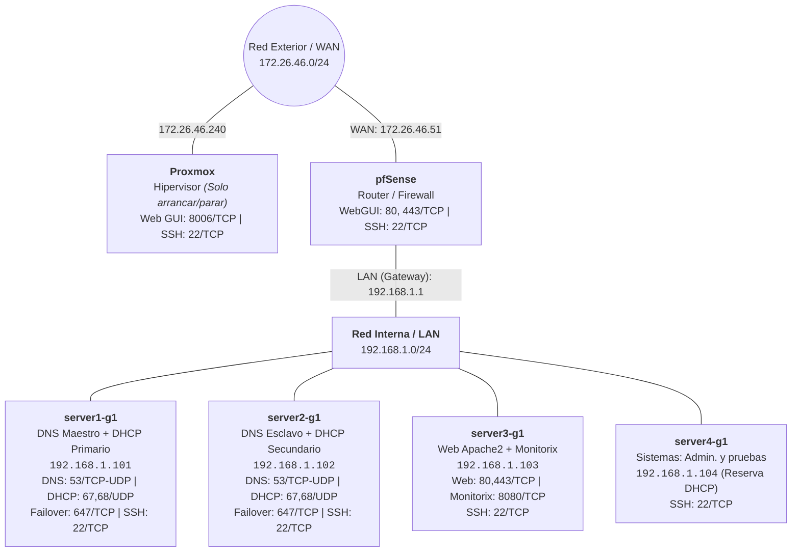

# Mapa Lógico de Red — Grupo 1 

* **Red WAN / Exterior:** `172.26.46.0/24`
* **Red LAN / Interna:** `192.168.1.0/24`

---

## 1. Diagrama Lógico (ASCII)

```text
                       [ Red Exterior / WAN ]
                          172.26.46.0/24
                                 |
        +------------------------+------------------------+
        | (172.26.46.240)                                 | (172.26.46.51)
  [  Proxmox  ]                                     [  pfSense  ]
  Hipervisor                                      Router / Firewall
  Web GUI: 8006/TCP | SSH: 22/TCP                 WebGUI: 80,443/TCP | SSH: 22/TCP
                                                          | (192.168.1.1 - Gateway)
                                                          |
  ========================================================+========================
                           Red Interna / LAN (192.168.1.0/24)
        |                         |                         |                         |
        | .101                    | .102                    | .103                    | .104 (Reserva DHCP)
  [ server1-g1 ]            [ server2-g1 ]            [ server3-g1 ]            [ server4-g1 ]
  DNS Maestro               DNS Esclavo               Web Apache2               Sistemas:
  DHCP Primario             DHCP Secundario           Monitorix                 Admin. y pruebas
  - DNS: 53 (TCP/UDP)       - DNS: 53 (TCP/UDP)       - HTTP/S: 80,443 (TCP)    - SSH: 22 (TCP)
  - DHCP: 67,68 (UDP)       - DHCP: 67,68 (UDP)       - Monitorix: 8080 (TCP)
  - Failover: 647 (TCP)     - Failover: 647 (TCP)     - SSH: 22 (TCP)
  - SSH: 22 (TCP)           - SSH: 22 (TCP)
```

---

## 2. Diagrama Lógico 


---

## 3. Resumen de Direccionamiento y Puertos

| Equipo / Hostname | Rol / Servicios | IP LAN (`192.168.1.0/24`) | IP WAN (`172.26.46.0/24`) | Puertos y Protocolos | Notas |
| :--- | :--- | :--- | :--- | :--- | :--- |
| **Proxmox** | Hipervisor | — | `172.26.46.240` | `8006/TCP` (Web GUI)<br>`22/TCP` (SSH) | Solo arrancar/parar VMs |
| **pfSense** | Router / Firewall | `192.168.1.1` | `172.26.46.51` | `80, 443/TCP` (WebGUI)<br>`22/TCP` (SSH) | Puerta de enlace (Gateway) LAN |
| **server1-g1** | DNS Maestro + DHCP Primario | `192.168.1.101` | — | `53/TCP, UDP` (DNS / AXFR)<br>`67, 68/UDP` (DHCP)<br>`647/TCP` (DHCP Failover)<br>`22/TCP` (SSH) | Estática |
| **server2-g1** | DNS Esclavo + DHCP Secundario | `192.168.1.102` | — | `53/TCP, UDP` (DNS / AXFR)<br>`67, 68/UDP` (DHCP)<br>`647/TCP` (DHCP Failover)<br>`22/TCP` (SSH) | Estática |
| **server3-g1** | Web Apache2 + Monitorix | `192.168.1.103` | — | `80/TCP` (HTTP)<br>`443/TCP` (HTTPS)<br>`8080/TCP` (Monitorix Web)<br>`22/TCP` (SSH) | Estática |
| **server4-g1** | Sistemas: Admin. y pruebas | `192.168.1.104` | — | `22/TCP` (SSH) | Asignada por Reserva DHCP |

> **Nota de arquitectura:** Aunque **Proxmox** se encuentra accesible en la red WAN para su administración y aloja virtualmente a todas las máquinas virtuales, a nivel lógico el tráfico de la red `192.168.1.0/24` se enruta exclusivamente a través de las interfaces de **pfSense**. El puerto `53/TCP` entre `server1-g1` y `server2-g1` es indispensable para las transferencias de zona (AXFR/IXFR) y el `647/TCP` para la sincronización del clúster DHCP.