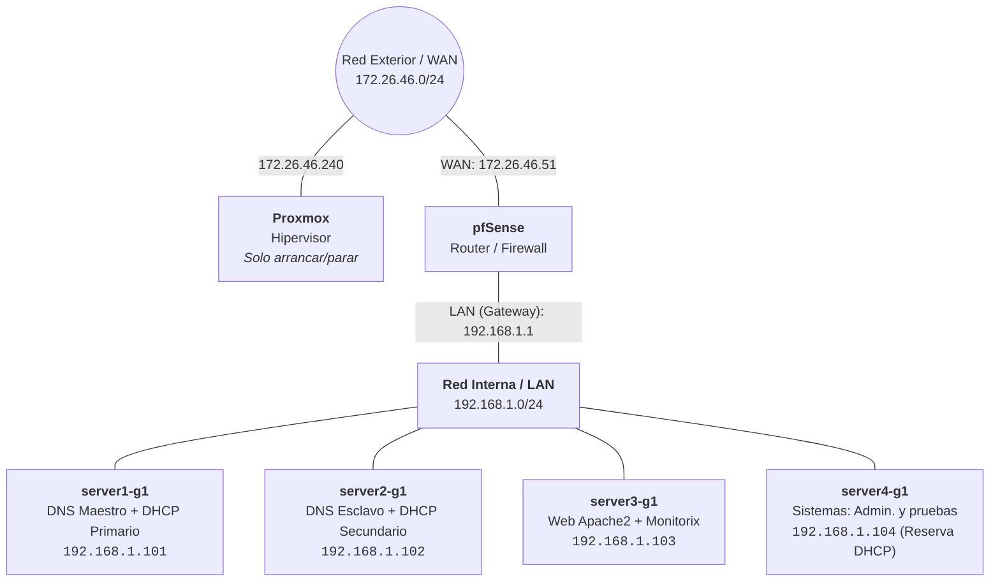

# Reto4_SRI_Grupo1
Este repositorio contiene la documentación técnica, configuración y gestión del despliegue de infraestructura virtualizada sobre **Proxmox** para el **Grupo 1**.

## 1. Descripción General de la Arquitectura

La infraestructura consta de una red externa (**WAN**) que proporciona conectividad y acceso a la gestión del hipervisor, y una red interna aislada (**LAN**) protegida y enrutada mediante un firewall **pfSense**. Dentro de la LAN operan cuatro servidores dedicados a servicios esenciales de red, web, monitorización y administración.

* **Red WAN / Exterior:** `172.26.46.0/24`
* **Red LAN / Interna:** `192.168.1.0/24`
* **Puerta de Enlace (Gateway) LAN:** `192.168.1.1`

> **Nota:** El hipervisor **Proxmox** (`172.26.46.240`) aloja las máquinas virtuales, pero su acceso está limitado estrictamente a tareas de encendido y apagado de las mismas. Todo el enrutamiento y filtrado de red recae sobre **pfSense**.

---

## 2. Tabla de Direccionamiento IP

| Equipo / Hostname | Rol / Servicios | IP LAN (`192.168.1.0/24`) | IP WAN (`172.26.46.0/24`) | Configuración IP / Notas |
| :--- | :--- | :--- | :--- | :--- |
| **Proxmox** | Hipervisor | — | `172.26.46.240` | Solo arrancar/parar VMs |
| **pfSense** | Router / Firewall | `192.168.1.1` | `172.26.46.51` | Gateway LAN / Interfaz WAN |
| **server1-g1** | DNS Maestro + DHCP Primario | `192.168.1.101` | — | IP Estática |
| **server2-g1** | DNS Esclavo + DHCP Secundario | `192.168.1.102` | — | IP Estática |
| **server3-g1** | Web Apache2 + Monitorix | `192.168.1.103` | — | IP Estática |
| **server4-g1** | Sistemas: Admin. y pruebas | `192.168.1.104` | — | Reserva DHCP (por MAC) |

---

## 3. Diagrama Lógico de Red

### Vista Gráfica (Mermaid)



### Vista Esquemática (ASCII)

```text
                       [ Red Exterior / WAN ]
                          172.26.46.0/24
                                 |
        +------------------------+------------------------+
        | (172.26.46.240)                                 | (172.26.46.51)
  [  Proxmox  ]                                     [  pfSense  ]
  Hipervisor                                      Router / Firewall
  (Gestión arranque/parada)                               | (192.168.1.1 - Gateway)
                                                          |
  ========================================================+========================
                           Red Interna / LAN (192.168.1.0/24)
        |                         |                         |                         |
        | .101                    | .102                    | .103                    | .104 (Reserva DHCP)
  [ server1-g1 ]            [ server2-g1 ]            [ server3-g1 ]            [ server4-g1 ]
  DNS Maestro               DNS Esclavo               Web Apache2               Sistemas:
  DHCP Primario             DHCP Secundario           Monitorix                 Admin. y pruebas
```

---
