# Informe técnico del proyecto de redes – Grupo 1, Reto 4

## 1. Introducción

En este proyecto se ha desplegado y configurado una infraestructura de red virtualizada formada por un firewall pfSense y cuatro servidores Ubuntu Server ejecutados sobre Proxmox. El objetivo es disponer de una red segmentada y controlada, con servicios de direccionamiento IP, resolución de nombres, acceso remoto, sincronización horaria, alojamiento web y monitorización.

El trabajo se ha organizado por fases. Primero se preparó la infraestructura virtual y el acceso remoto; después se configuró pfSense como puerta de enlace y cortafuegos; a continuación se implantaron los servicios DHCP y DNS redundantes; por último, se instaló Apache2 y Monitorix en Server3 y se prepararon los nombres DNS para acceder a los servicios.

Las capturas incluidas en este documento muestran las pantallas de configuración y las pruebas realizadas durante el desarrollo. Las direcciones y nombres se mantienen tal como aparecen en el material del proyecto.

## 2. Topología y direccionamiento

La infraestructura utiliza cuatro máquinas Ubuntu Server conectadas a la LAN protegida por pfSense. Cada servidor tiene una función principal:

| Equipo | Dirección IP | Función principal |
|---|---:|---|
| pfSense WAN | `172.26.46.51` | Puerta de enlace y firewall de la WAN |
| Server1 | `192.168.1.101` | DHCP primario y DNS maestro |
| Server2 | `192.168.1.102` | DHCP secundario y DNS esclavo |
| Server3 | `192.168.1.103` | Servidor web Apache2 y Monitorix |
| Server4 | `192.168.1.104` | Cliente DHCP con dirección reservada |

El dominio utilizado para los servicios DNS es `grupo1reto4.eus`. En la configuración inicial de las máquinas virtuales también se establecen el nombre de host, la puerta de enlace, los servidores DNS y el dominio de búsqueda.

## 3. Preparación de las máquinas virtuales en Proxmox

### 3.1. Configuración mediante Cloud-Init

Se utiliza Cloud-Init desde Proxmox para establecer los parámetros iniciales de las máquinas virtuales. Esta herramienta permite introducir los datos de red y de identificación antes de iniciar cada servidor.

En cada máquina se configura:

- **Hostname:** nombre que identifica al servidor (`Server1`, `Server2`, `Server3` o `Server4`).
- **Dirección IP:** dirección estática correspondiente a cada servidor, excepto cuando Server4 se configura posteriormente como cliente DHCP.
- **Gateway:** puerta de enlace de la LAN, `192.168.1.1`.
- **DNS:** servidores encargados de resolver los nombres de dominio.
- **Dominio:** `grupo1reto4.eus`.

La asignación inicial de direcciones facilita que los servicios de infraestructura se encuentren siempre en la misma IP. Esto es especialmente importante para DHCP, DNS, Apache y las reglas de firewall, que necesitan conocer las direcciones de los equipos.

**Evidencias de configuración:**

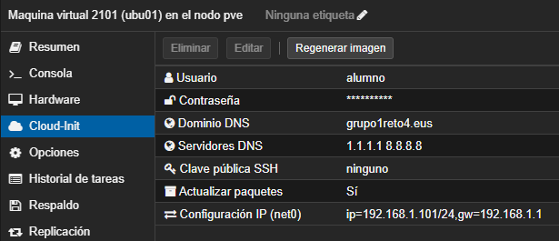


## 4. Configuración inicial de pfSense

pfSense se utiliza como router y cortafuegos entre la red WAN y la LAN del proyecto. Su función es controlar el tráfico que entra y sale de la red interna, además de permitir únicamente las comunicaciones necesarias para acceder a los servicios.

En la configuración se establecen las interfaces de red y sus direcciones. La interfaz LAN actúa como puerta de enlace de los servidores, mientras que la interfaz WAN conecta con la red exterior del laboratorio.

También se preparan las redirecciones de puertos (*port forwarding*). Una redirección permite que una conexión que llega a una dirección y puerto de pfSense se envíe al servidor interno y puerto correspondiente. De esta forma, los servicios pueden publicarse sin asignar directamente una dirección pública a cada servidor.


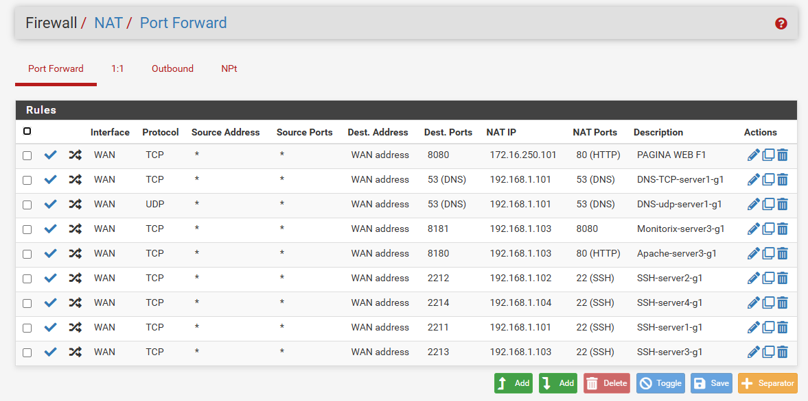

## 5. Acceso remoto mediante SSH y sincronización horaria

### 5.1. Creación y distribución de claves SSH

SSH permite administrar los servidores desde otro equipo mediante una conexión cifrada. Para evitar depender del acceso por contraseña, se generan claves criptográficas y se instala la clave pública en los servidores autorizados.

En el equipo cliente se genera una clave Ed25519 con el comando:

```bash
ssh-keygen -t ed25519 -C "Joel"
```

El proceso genera una clave privada y otra pública. La clave privada debe permanecer protegida en el equipo del usuario y no debe subirse al repositorio de GitHub. La clave pública sí se puede instalar en el archivo `authorized_keys` de los usuarios de los servidores.

Una vez instalada la clave pública, el cliente puede autenticarse mediante el par de claves. Esto facilita la administración remota y evita introducir la contraseña en cada conexión.

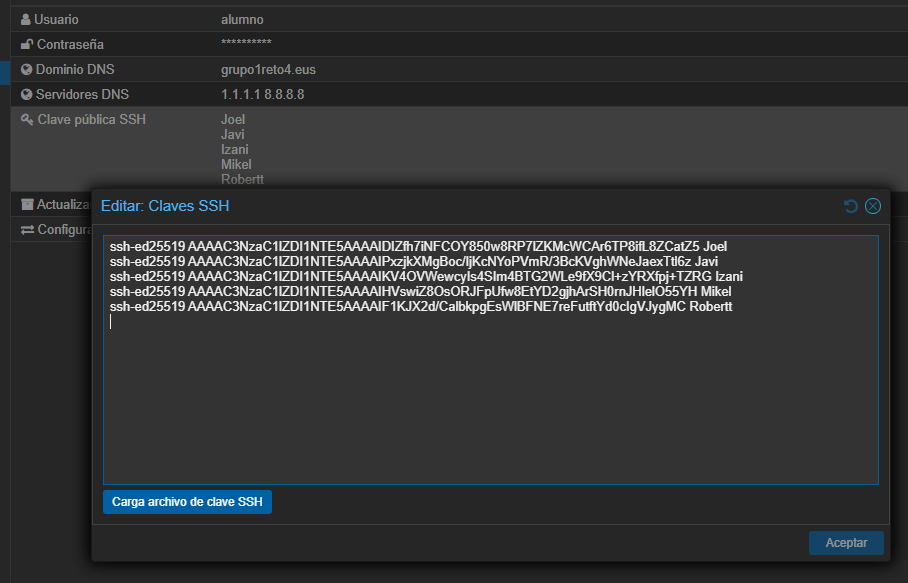

### 5.2. Archivo de configuración SSH

Se crea un archivo `config` en el directorio `.ssh` del equipo cliente. En él se pueden definir alias para los servidores, asociando a cada alias su dirección, puerto, usuario y clave privada.

Así, en lugar de escribir todos los parámetros de conexión, se puede utilizar un nombre corto para conectarse a cada servidor. Esto también simplifica las operaciones de copia de archivos mediante `scp`.


### 5.3. Acceso a los servidores

Una vez distribuidas las claves y preparado el archivo de configuración, se comprueba el acceso remoto a las máquinas. La prueba permite verificar que el servicio SSH está disponible y que la autenticación con claves funciona.

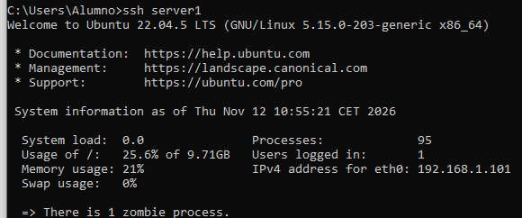

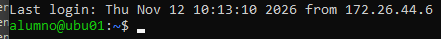


### 5.4. Sincronización horaria (NTP)

La sincronización horaria permite que todos los servidores mantengan una hora coherente. Es importante para comparar registros, analizar incidencias y ordenar cronológicamente los eventos de los distintos equipos.

## Servicio NTP – Sincronización horaria

Se instaló y configuró el servicio **NTP mediante Chrony** para mantener sincronizada la hora de los servidores Ubuntu. Esto permite que todos los equipos trabajen con la misma referencia horaria y que los registros de los servicios tengan marcas de tiempo coherentes.

### Instalación de Chrony

En primer lugar, se actualizaron los repositorios y se instaló el servicio:

```bash
sudo apt update
sudo apt install chrony -y
```

### Configuración del servidor horario

Se editó el archivo de configuración `/etc/chrony/chrony.conf` y se añadió el servidor horario de referencia:

```bash
server hora.roa.es iburst prefer
```

También se configuró la zona horaria de España:

```bash
sudo timedatectl set-timezone Europe/Madrid
```

### Reinicio y comprobación del servicio

Se reinició Chrony para aplicar los cambios:

```bash
sudo systemctl restart chrony
```

Finalmente, se utilizaron los siguientes comandos para comprobar el estado del servicio y la sincronización:

```bash
systemctl status chrony
chronyc sources -v
chronyc tracking
timedatectl status
```

Con estas comprobaciones se puede verificar que Chrony está funcionando, consultar las fuentes horarias configuradas y comprobar el estado de sincronización del sistema.

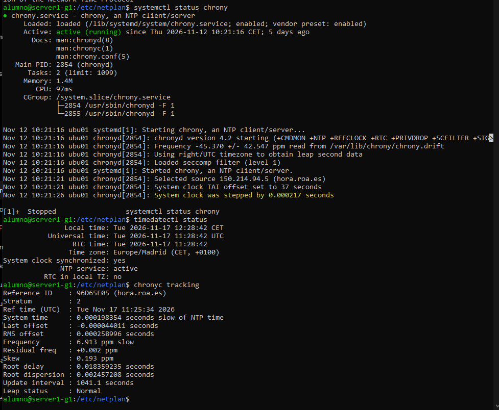

## 6. Fase 1 – Firewall pfSense

### 6.1. Deshabilitar el DHCP de pfSense

Se desactiva el servidor DHCP integrado en pfSense para la interfaz LAN. El motivo es que el servicio DHCP será proporcionado por Server1 y Server2, que forman un sistema redundante.

Es importante que no haya varios servidores DHCP independientes entregando direcciones en la misma red sin coordinación, ya que podrían asignar configuraciones incompatibles o direcciones duplicadas.

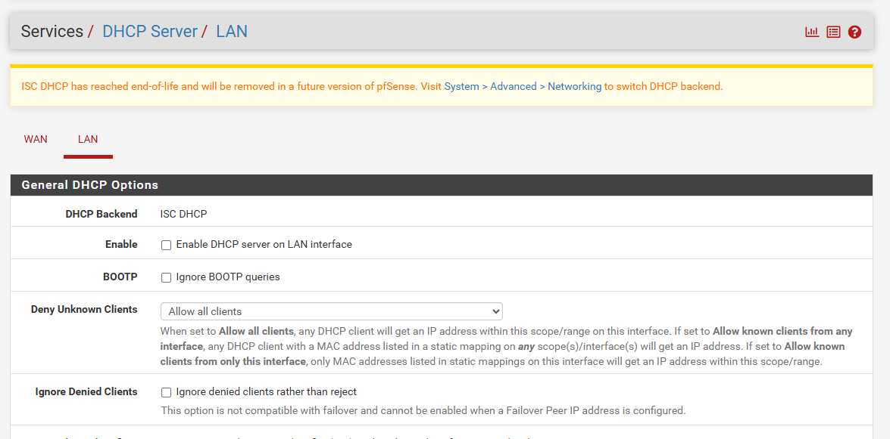

### 6.2. Política restrictiva del firewall

Se aplica una política de seguridad restrictiva: el tráfico debe estar permitido de forma explícita cuando sea necesario y no se deben utilizar reglas abiertas a cualquier origen o destino (`any`). El planteamiento del proyecto también indica que no se debe utilizar una DMZ.

Este enfoque reduce la superficie de exposición de los servidores. Para cada servicio se deben definir el origen autorizado, el destino, el protocolo y el puerto que necesita utilizar.

### 6.3. Redirección de puertos

Se configuran las reglas de *port forwarding* necesarias para publicar servicios internos a través de la dirección WAN de pfSense. La redirección asocia un puerto de entrada con la IP y el puerto del servidor que ofrece el servicio.

En el proyecto se documentan redirecciones para el acceso SSH a los servidores y para los servicios web y de monitorización. Las reglas deben limitarse a los equipos o redes del aula autorizados, de acuerdo con los requisitos del laboratorio.

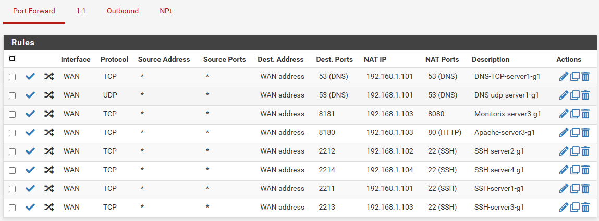

## 7. Fase 2 – DHCP redundante mediante Failover

### 7.1. Objetivo del servicio DHCP

DHCP (*Dynamic Host Configuration Protocol*) asigna automáticamente a los clientes los parámetros necesarios para comunicarse en la red, como la dirección IP, la máscara, la puerta de enlace y los servidores DNS.

Para evitar que la caída de un único servidor deje a los clientes sin servicio de asignación de direcciones, se configura DHCP redundante mediante ISC DHCP Server:

- **Server1 (`192.168.1.101`):** servidor DHCP primario.
- **Server2 (`192.168.1.102`):** servidor DHCP secundario.
- **Server4:** cliente DHCP que debe recibir una dirección reservada.

Los dos servidores coordinan el estado de las concesiones mediante el mecanismo *failover*. Así, el servidor secundario puede continuar atendiendo a los clientes si el primario deja de estar disponible, siempre que la relación de failover esté correctamente configurada y sincronizada.

### 7.2. Instalación de ISC DHCP Server

Se instala el paquete `isc-dhcp-server` en Server1 y Server2. Este paquete proporciona el servicio DHCP y los archivos de configuración necesarios para definir las redes, los rangos de direcciones y los parámetros que se entregarán a los clientes.

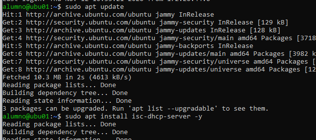

### 7.3. Configuración de Server1 como primario

Server1 se configura como miembro primario de la relación de failover. En su configuración se define la relación con Server2, indicando las direcciones de ambos servidores y los parámetros de coordinación.

También se configura la subred que se va a administrar, el rango dinámico de direcciones y los parámetros que recibirán los clientes. La reserva de Server4 permite asociar una dirección concreta a su dirección MAC, de modo que el cliente obtenga siempre la IP prevista.

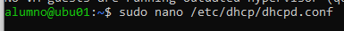


### 7.4. Selección de la interfaz de escucha

Se indica la interfaz de red por la que debe escuchar el servicio DHCP. En el documento se especifica `eth0` para Server1 y Server2.

Esta selección evita que el servicio intente atender peticiones por interfaces que no pertenecen a la red de clientes del proyecto.


### 7.5. Comprobación y arranque del servicio

Después de editar los archivos de configuración, se comprueba que la sintaxis sea correcta y se inicia el servicio. La comprobación previa permite detectar errores antes de poner el servicio en funcionamiento.

Se revisa el estado del servicio en los dos servidores para comprobar que están activos.

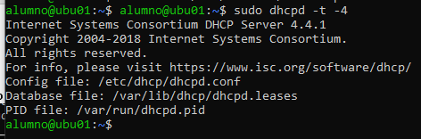


### 7.6. Configuración de Server4 como cliente DHCP

Server4 deja de utilizar una dirección configurada manualmente en su interfaz y pasa a solicitar los parámetros de red mediante DHCP.

Al iniciar el cliente DHCP, Server4 envía una solicitud a la red. El servidor DHCP identifica al equipo y, gracias a la reserva asociada a su MAC, le entrega la dirección prevista: `192.168.1.104`.


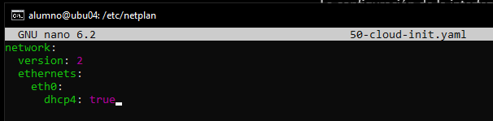

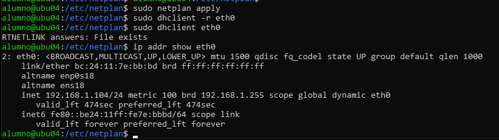

### 7.7. Prueba de failover

La prueba de redundancia consiste en comprobar que Server4 puede seguir obteniendo o renovando su configuración cuando Server1 deja de prestar servicio.

El procedimiento documentado es:

1. Comprobar que Server4 tiene la dirección reservada `192.168.1.104`.
2. Detener temporalmente el servicio DHCP de Server1.
3. Forzar una renovación de la concesión DHCP desde Server4.
4. Comprobar la dirección que mantiene u obtiene el cliente.
5. Volver a iniciar el servicio DHCP de Server1 al terminar la prueba.

La finalidad es verificar que Server2 puede asumir la atención de los clientes cuando el servidor primario no está disponible. La prueba debe realizarse con ambos servidores correctamente sincronizados.


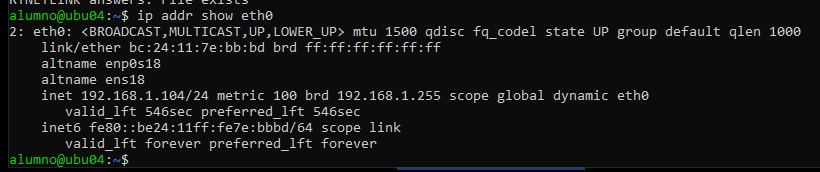

## 8. Fase 3 – DNS redundante con BIND9 maestro-esclavo

### 8.1. Objetivo del servicio DNS

DNS (*Domain Name System*) traduce nombres de dominio en direcciones IP. Gracias a este servicio, los usuarios pueden acceder a los servidores mediante nombres como `server3.grupo1reto4.eus`, sin tener que recordar sus direcciones numéricas.

Se utiliza BIND9 y se distribuye el servicio entre dos servidores:

- **Server1 (`192.168.1.101`):** servidor DNS maestro. Contiene las zonas originales y permite administrar sus registros.
- **Server2 (`192.168.1.102`):** servidor DNS esclavo. Recibe copias de las zonas desde el maestro y puede responder consultas cuando el maestro no está disponible.

La redundancia DNS permite mantener la resolución de nombres aunque uno de los dos servidores tenga una incidencia.

### 8.2. Instalación de BIND9 en Server1

Se instala BIND9 en Server1 junto con las utilidades de diagnóstico DNS. BIND9 es el servicio que atenderá las consultas y gestionará las zonas configuradas para el dominio del proyecto.

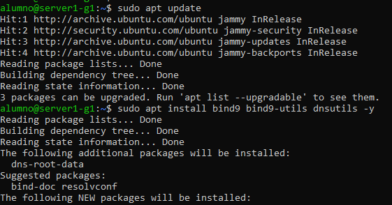

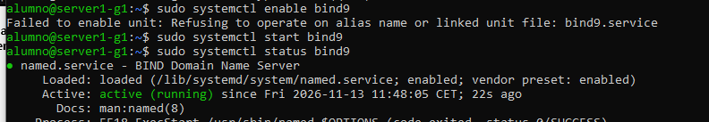

### 8.3. Configuración de Server1 como maestro

Server1 se configura como maestro de las zonas DNS. En el archivo de configuración local se declaran las zonas que va a administrar y se indica dónde se encuentran sus archivos de datos.

La zona directa contiene los registros que relacionan nombres con direcciones IP. Las zonas inversas permiten realizar la operación contraria: consultar qué nombre corresponde a una dirección IP.

Para permitir la redundancia, el maestro debe autorizar que Server2 transfiera las zonas. La transferencia se restringe al servidor esclavo autorizado, en lugar de permitirla a cualquier equipo.


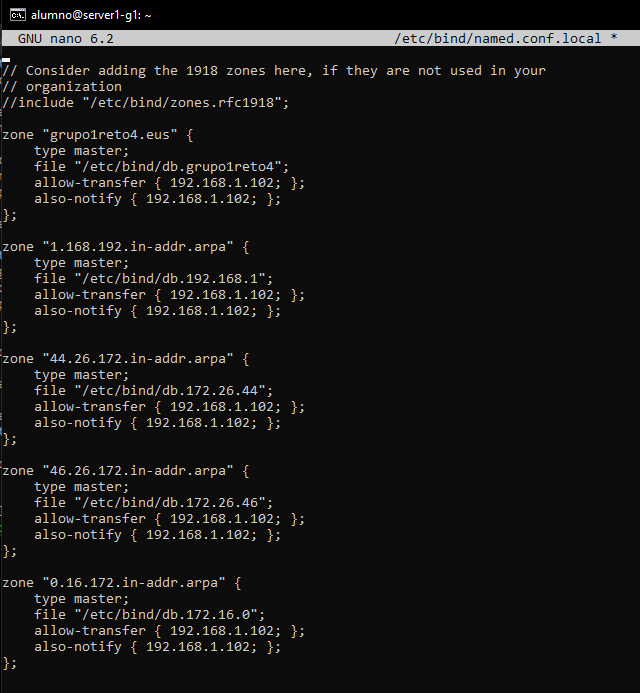

### 8.4. Creación de la zona directa

La zona directa del dominio `grupo1reto4.eus` contiene los registros que permiten localizar los equipos y servicios por su nombre.

Entre los tipos de registros utilizados se encuentran:

- **A:** asocia un nombre con una dirección IPv4.
- **CNAME:** crea un alias que apunta a otro nombre DNS.
- **NS:** identifica los servidores autoritativos de la zona.
- **SOA:** contiene información administrativa de la zona, incluido su número de serie.

Cada vez que se modifica el contenido de una zona, se debe actualizar su número de serie. Este valor permite que el servidor esclavo detecte que existe una versión más reciente y solicite la actualización.


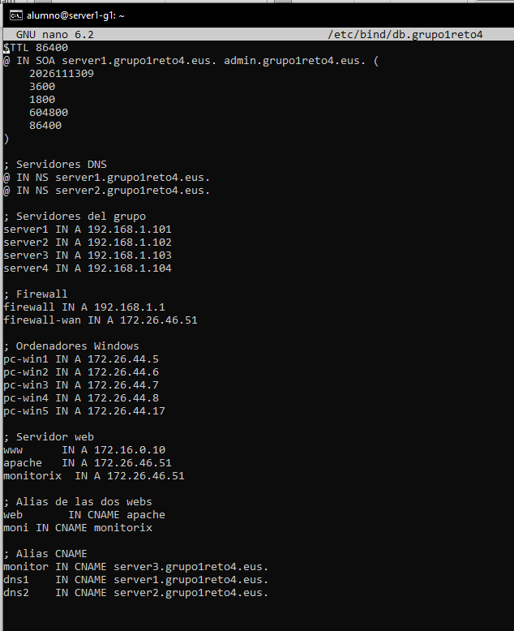

### 8.5. Zonas inversas

Se crean zonas inversas para las redes documentadas en el proyecto. Estas zonas utilizan registros PTR, que relacionan una dirección IP con un nombre de host.

La resolución inversa resulta útil para diagnósticos, registros de actividad y comprobaciones de red. Permite, por ejemplo, consultar el nombre asociado a la IP de uno de los servidores.

#### 8.5.1. Zona inversa de la red interna

Se configura la zona inversa correspondiente a la red `192.168.1.0`. En ella se incorporan los registros PTR de los equipos de la LAN, entre ellos pfSense y los cuatro servidores.


#### 8.5.2. Zona inversa de los equipos Windows

Se documenta la zona inversa de la red de los equipos Windows del aula. Su finalidad es que las direcciones de esos equipos también puedan resolverse a nombres, siempre que exista conectividad y que los registros correspondan a las direcciones utilizadas.

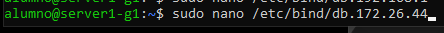

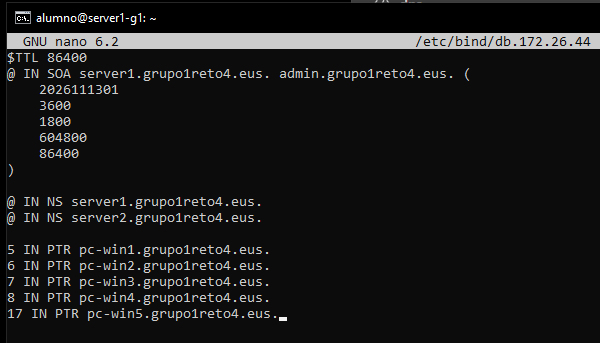

#### 8.5.3. Zona inversa de la WAN del firewall

Se configura la zona inversa asociada a la red WAN utilizada por pfSense. Esto permite disponer de resolución inversa para la dirección de la interfaz WAN que aparece en el proyecto.


#### 8.5.4. Zona inversa del servidor web

Se añade la zona inversa correspondiente a la red del servidor web externo al segmento LAN del proyecto. De esta manera también se puede consultar el nombre asociado a la IP del servidor web.


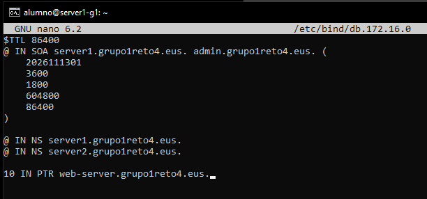

### 8.6. Opciones generales de BIND9

Se configuran las opciones generales del servicio DNS, incluyendo qué equipos o redes pueden realizar consultas y qué servidores están autorizados para recibir transferencias de zona.

Limitar las consultas y las transferencias es una medida de seguridad importante. Un servidor DNS no debe permitir transferencias de sus zonas a clientes no autorizados, ya que podrían obtener información completa sobre los nombres y direcciones de la infraestructura.

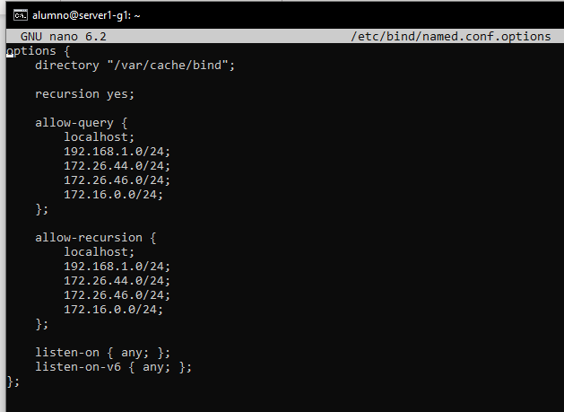

### 8.7. Comprobación del servidor maestro

Una vez configuradas las zonas y las opciones, se valida la configuración y se comprueba que BIND9 está funcionando en Server1. También se realizan consultas DNS para verificar que los nombres configurados devuelven los resultados esperados.

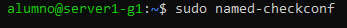

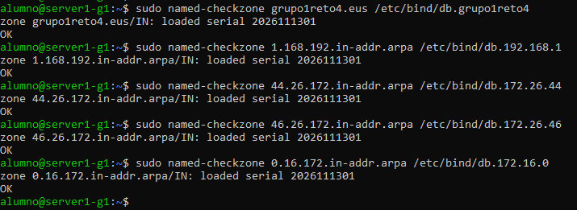

La documentación del proyecto identifica Server1 como el servidor DNS maestro.

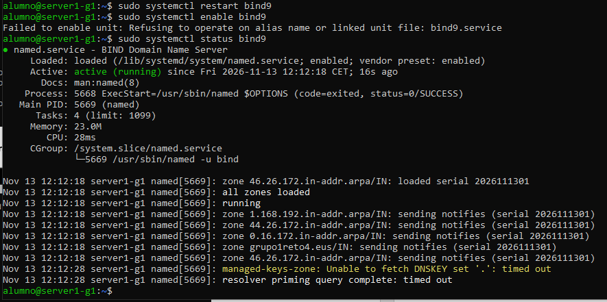

### 8.8. Configuración de Server2 como esclavo

#### 8.8.1. Instalación de BIND9

Se instala BIND9 en Server2 para que pueda actuar como servidor DNS secundario. Aunque utiliza el mismo software, su función es diferente: no se editan las zonas como originales, sino que se reciben desde Server1.

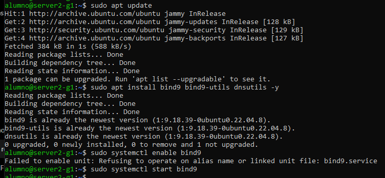

#### 8.8.2. Declaración de las zonas esclavas

Server2 se configura como esclavo de Server1. Para cada zona se especifica la dirección del maestro y la ubicación donde se guardará la copia transferida.

Cuando el esclavo detecta una actualización, puede solicitar una transferencia al maestro. También puede recibir una notificación de actualización si el maestro tiene configurado el mecanismo correspondiente.


#### 8.8.3. Permitir consultas DNS

Se ajustan las opciones de BIND9 para que Server2 pueda responder a las consultas procedentes de las redes autorizadas. De este modo, los clientes pueden utilizar el servidor secundario como alternativa al maestro.

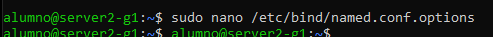


#### 8.8.4. Reinicio y comprobación de las zonas

Después de guardar los cambios, se reinicia el servicio y se comprueba que Server2 ha recibido las zonas desde Server1. La presencia de los archivos de zona y la resolución de los nombres permiten comprobar que la configuración esclava está operativa.

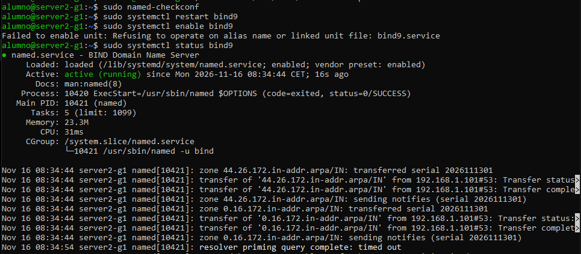

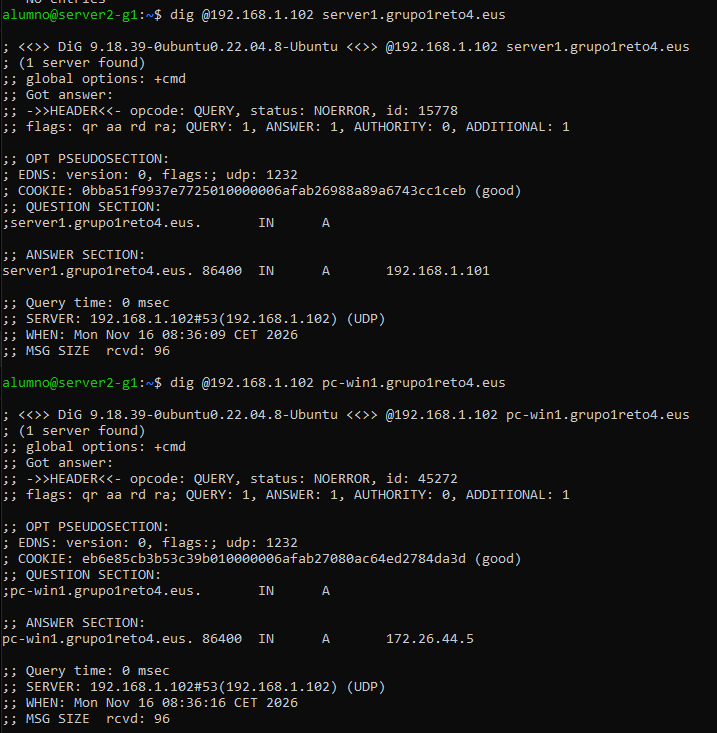


También se realizan consultas inversas para comprobar los registros PTR.

### 8.9. Pruebas de redundancia DNS

#### 8.9.1. Comprobar la transferencia de actualizaciones

Para comprobar que el maestro y el esclavo están sincronizados, se modifica el número de serie de una zona en Server1. El número de serie debe incrementarse cada vez que se realiza una modificación.

Después se valida y recarga la zona en el maestro. Server2 debe detectar el nuevo número de serie y actualizar su copia. Si ambos servidores muestran el mismo serial actualizado, se confirma que la transferencia de la zona se ha realizado.


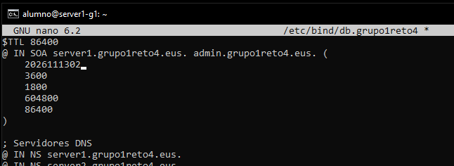


#### 8.9.2. Detener el maestro y consultar el esclavo

La segunda prueba consiste en detener temporalmente el servicio DNS de Server1 y realizar consultas directamente contra Server2.

Si Server2 conserva las zonas y responde correctamente, se demuestra que puede seguir proporcionando resolución DNS sin depender en ese momento del servicio maestro.

Al finalizar la prueba se vuelve a iniciar el servicio en Server1 para recuperar el funcionamiento normal de ambos servidores.


## 9. Fase 4 – Servidor web Apache2 y monitorización con Monitorix

### 9.1. Instalación y configuración de Apache2 en Server3

Apache2 es el servidor web utilizado para publicar una página web desde Server3. El servicio escucha las peticiones HTTP y entrega al navegador los archivos de la página almacenados en el servidor.

La instalación y configuración de Apache se realiza en Server3 (`192.168.1.103`). Se prepara el directorio que contiene la página web y se configura el sitio para que Apache sepa qué contenido debe servir cuando recibe una petición para el nombre de dominio correspondiente.

La configuración de un sitio web puede definir, entre otros parámetros, el nombre del servidor, el directorio raíz de documentos y los archivos de registro de accesos y errores. Los registros permiten revisar las peticiones recibidas y detectar problemas.

Las capturas de este apartado documentan la instalación, los archivos de configuración y las pruebas de acceso al sitio.


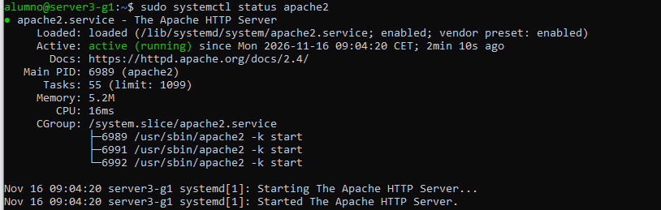


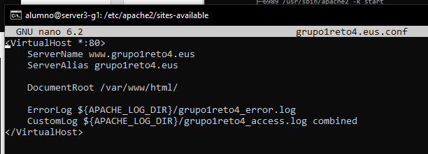


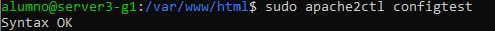


### 9.2. Instalación de Monitorix

Monitorix es una herramienta de monitorización que permite consultar gráficas y estadísticas del estado y la actividad del servidor. Se instala en Server3 para disponer de una interfaz web desde la que observar información del sistema.

La instalación añade el servicio y sus archivos de configuración. Una vez instalado, se comprueba que el servicio está habilitado y en ejecución.


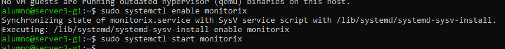


### 9.3. Configuración del puerto de Monitorix

Se modifica el archivo de configuración de Monitorix para establecer los parámetros del servidor web integrado. En el proyecto se utiliza el puerto `8080` para acceder a la interfaz de Monitorix desde el navegador.

Separar el puerto de Monitorix del puerto HTTP de Apache permite alojar ambos servicios en el mismo servidor sin que intenten utilizar el mismo puerto de escucha.

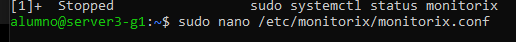


Después de modificar el archivo, se reinicia Monitorix y se comprueba que el proceso está escuchando en el puerto configurado.

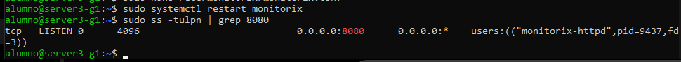

### 9.4. Prueba de acceso a Monitorix

Se comprueba el acceso a Monitorix desde el propio Server3 y desde un navegador. La interfaz se publica bajo la ruta `/monitorix/`.

La prueba permite verificar que el servicio responde por el puerto configurado y que la interfaz gráfica está disponible para consultar las estadísticas.

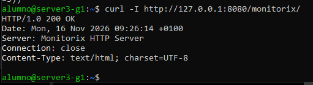

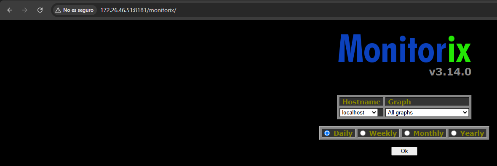

## 10. Configuración de nombres DNS en el firewall y acceso mediante alias

Además de crear los registros DNS en Server1, se documenta la configuración del resolver DNS en pfSense para que los equipos puedan utilizar los nombres y alias establecidos.

Los registros de tipo CNAME permiten crear nombres alternativos para un nombre DNS existente. Por ejemplo, un alias puede facilitar el acceso a un servicio sin tener que recordar el nombre principal del servidor.

Es importante distinguir entre el nombre DNS y el puerto del servicio: DNS resuelve el nombre a una dirección IP, pero no asigna puertos. Cuando un servicio utiliza un puerto distinto del habitual, ese puerto debe indicarse en la URL del navegador.


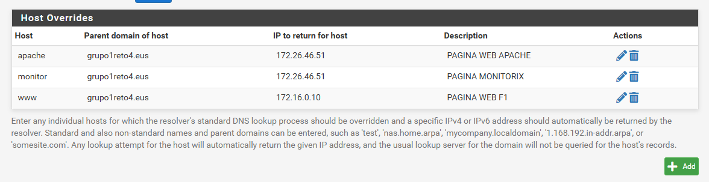

## 11. Direcciones de acceso a los servicios

El documento original recoge las siguientes direcciones de acceso:

| Servicio | Acceso mediante IP | Acceso mediante nombre |
|---|---|---|
| Apache | `http://172.26.46.51:8180/` | `http://apache.grupo1reto4.eus:8180/` |
| Página web F1 | `https://172.16.250.101/` | `http://www.grupo1reto4.eus/` |
| Monitorix | `http://172.26.46.51:8181/monitorix/` | `http://monitorix.grupo1reto4.eus:8181/monitorix` |


## 12. Seguridad y buenas prácticas

Durante el despliegue se deben mantener las siguientes medidas:

- Mantener una política restrictiva en pfSense y abrir únicamente los puertos necesarios.
- Evitar reglas de firewall con origen o destino `any` cuando el acceso puede limitarse a los equipos del aula.
- Mantener las claves privadas SSH fuera del repositorio.
- Publicar únicamente las claves públicas SSH cuando sea necesario documentar el acceso.
- Restringir las transferencias de zonas DNS al servidor esclavo autorizado.
- Permitir consultas DNS únicamente desde las redes previstas para el proyecto.
- No incluir contraseñas, tokens, claves privadas ni datos de acceso en GitHub.
- Documentar los cambios de configuración y las pruebas realizadas.

## 13. Conclusiones

El proyecto permite desplegar una infraestructura de red virtualizada con servicios separados por función. pfSense proporciona el control de tráfico y las redirecciones necesarias; Server1 y Server2 ofrecen redundancia para los servicios DHCP y DNS; Server3 aloja Apache2 y Monitorix; y Server4 se utiliza para comprobar la asignación automática de direcciones.

Las pruebas de failover DHCP y de funcionamiento DNS maestro-esclavo son especialmente importantes porque permiten comprobar que la infraestructura no depende de un único servidor para ofrecer servicios esenciales. Por su parte, Apache2 y Monitorix proporcionan servicios de publicación web y supervisión del servidor.

La documentación gráfica complementa las explicaciones y permite identificar los pasos de configuración realizados en cada fase.

## 14. Anexo – Organización de las capturas

Las imágenes utilizadas en este documento se encuentran en la carpeta `capturas/` y se insertan mediante rutas relativas. Para que GitHub las muestre correctamente, hay que mantener la carpeta `capturas` junto al archivo `informe-tecnico.md`.

