# Informe del proyecto de redes – Grupo 1, Reto 4

> Documento pasado a Markdown a partir del informe original. Se han conservado sus apartados y se han extraído las imágenes a `capturas/`.

Configuración Proxmox IPs:

Cloud-Init: Configurar red estática (IP, gateway 192.168.X.1, DNS, dominio y hostname) en la pestaña Cloud-Init de Proxmox.

Server1:

Server2:

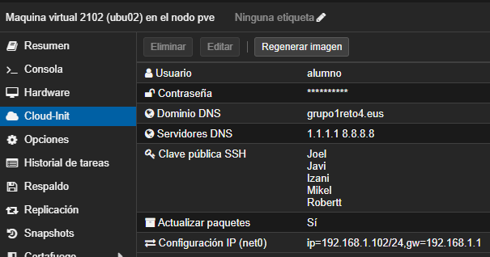

Server3:

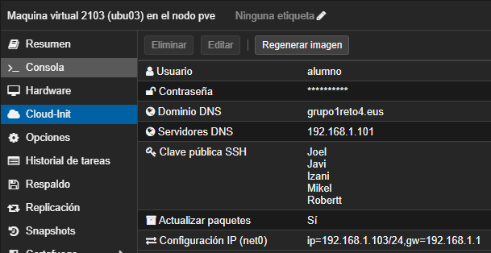

Server4:

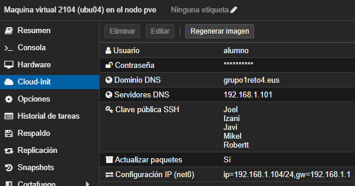

Configuración Pfsense:

Router,

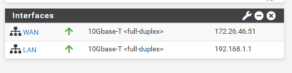

Redireccionando los servidores a puertos,

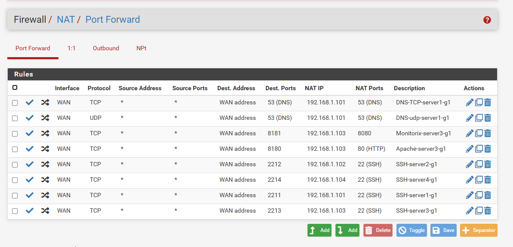

Creación de claves y acceso por ssh:

Primero creamos las claves de todo el grupo y después adjuntamos todas las claves a los diferentes servidores.

Creación clave:

ssh-keygen -t ed25519 -C "Joel"

Después adjuntamos las claves a los servidores,

Creamos archivo config para poner el host y te lleve a la ip con la clave correcta.

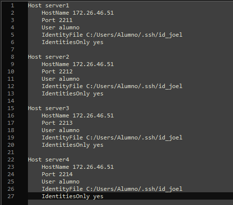

Entramos a los servers,

Identificacion:

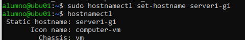

Sincronización (NTP)

Fase 1: Firewall pfSense

DHCP Local: Deshabilitar el servidor DHCP del pfSense en la LAN.

Política Restrictiva: Denegar por defecto. Prohibido usar DMZ o reglas "any".

Apertura de Puertos (Port Forwarding limitados al aula):

Fase 2: DHCP Redundante - Failover

Instalar el servicio DHCP (Esto lo hacemos en server1 y server2)

Vamos a utilizar ISC DHCP Server, que permite configurar el protocolo de failover.

Configurar Server1 como DHCP primario

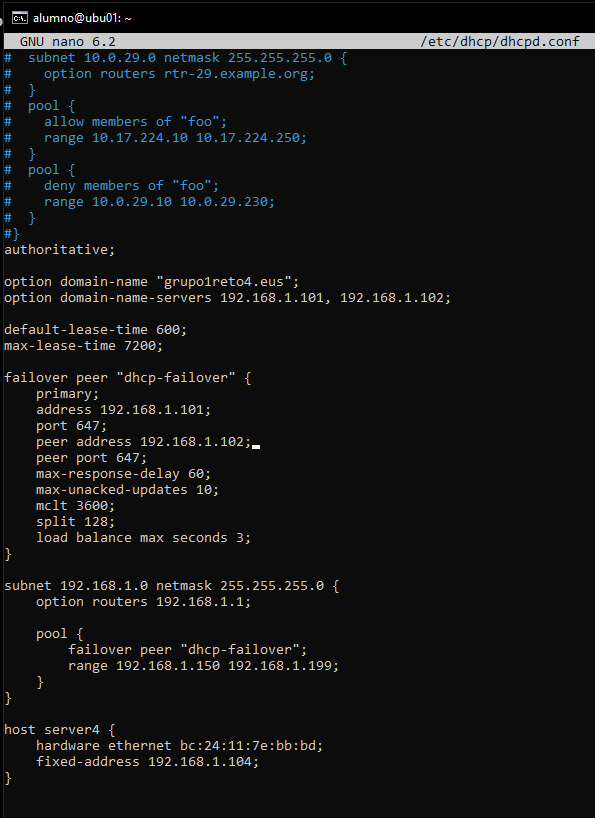

Indicar la interfaz de red

En ambos servidores, comprueba que el servicio DHCP escucha en eth0. (Server1 y 2)

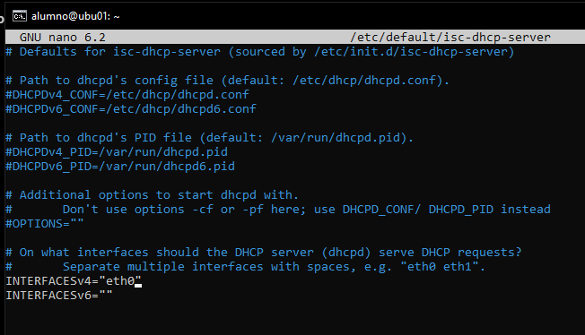

Comprobar y arrancar los servicios

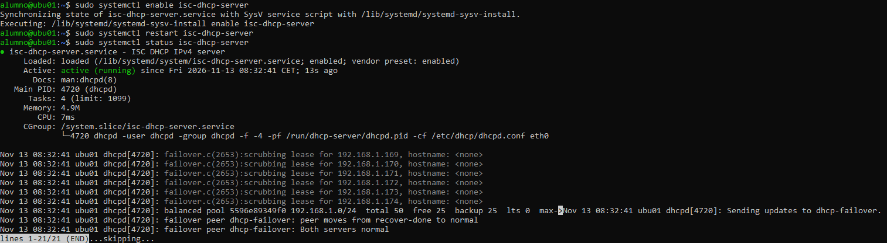

Configurar Server4 como cliente DHCP

Ahora vamos a quitar la IP estática de Server4 y hacer que la obtenga mediante DHCP.

En Server4:

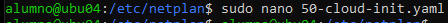

La configuración de la interfaz debe quedar aproximadamente así:

Server4 debe obtener la dirección reservada:

Prueba de failover

Cuando los dos servidores estén funcionando y sincronizados:

Comprueba que Server4 tiene 192.168.1.104.

Detén el DHCP de Server1:

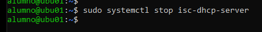

En Server4, fuerza una renovación:

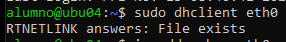

Comprueba la dirección:

Fase 3: DNS Redundante - Maestro-Esclavo

Instalar BIND9 en Server1

Configurar Server1 como maestro

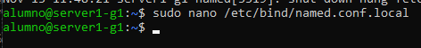

Crear la zona directa

En Server1 ejecuta:

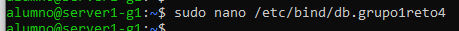

Crear la zona inversa de la red interna

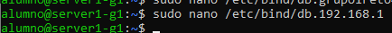

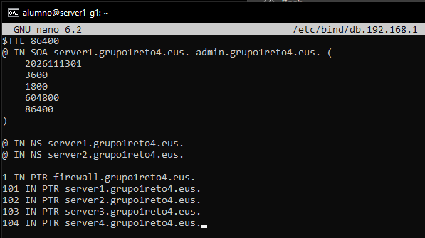

Crear la zona inversa de los PC Windows

Crear la zona inversa del firewall WAN

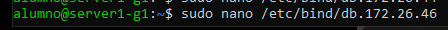

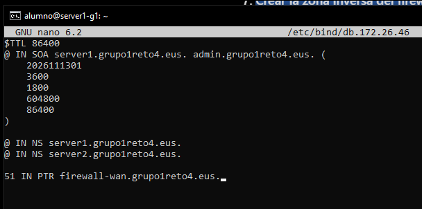

Crear la zona inversa del servidor web

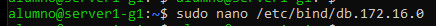

Configurar las opciones generales de BIND9

En Server1:

Comprobar Server1

Server1 ya funciona como maestro.

PARTE 2 – SERVER2 COMO ESCLAVO

Instalar BIND9 en Server2

Configurar Server2 como esclavo

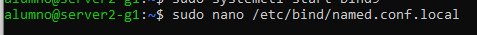

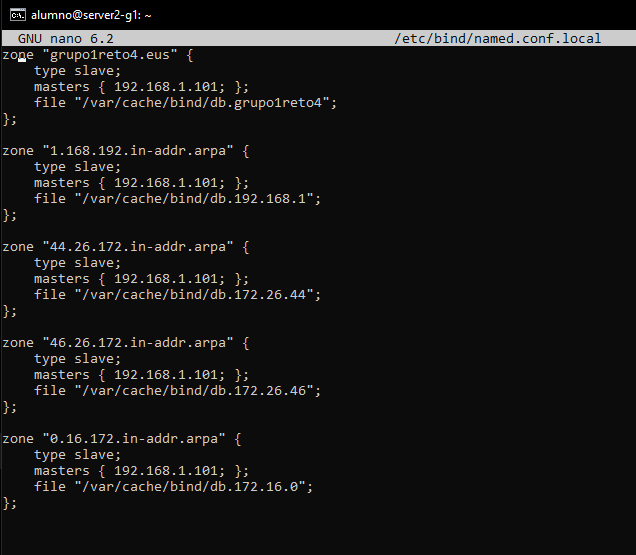

Configurar las consultas DNS de Server2

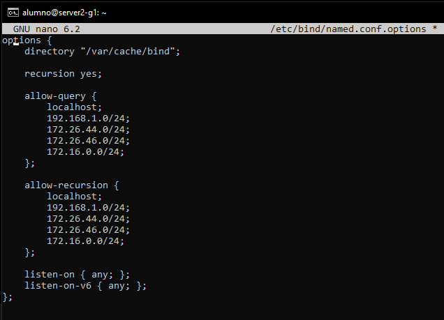

Guardamos y reiniciamos

Comprobar que Server2 recibe las zonas

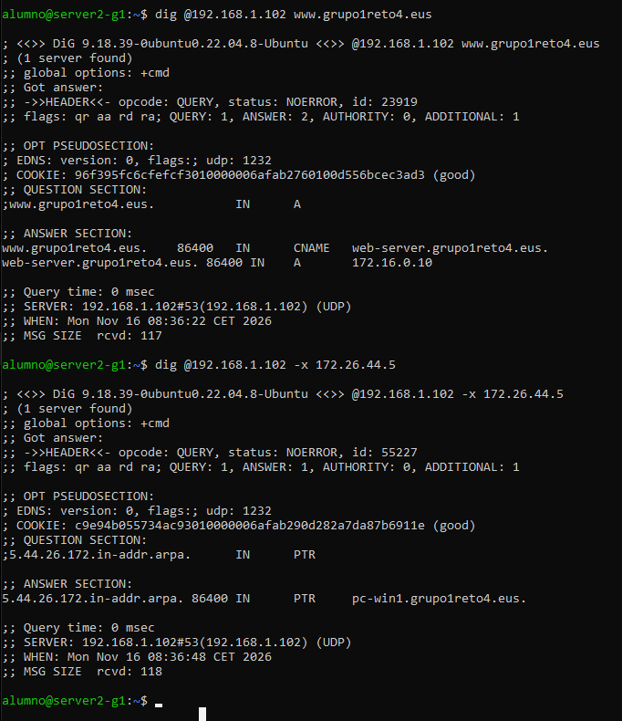

Comprobamos la zona inversiva

PARTE 3 – PRUEBA DE REDUNDANCIA

Comprobar la transferencia automática

En Server1:

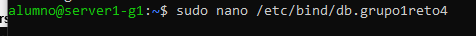

Cambiamos el serial,

Guardamos y ejecutamos,

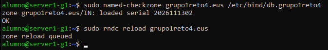

En Server2:

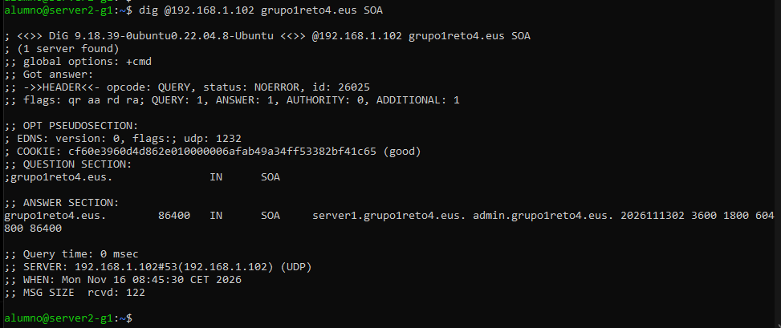

Si aparece el serial demuestra que Server2 ha recibido la actualización.

Detener Server1 y comprobar Server2

En Server1:

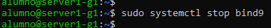

Ahora, desde Server2 o desde otro equipo con conectividad hacia él:

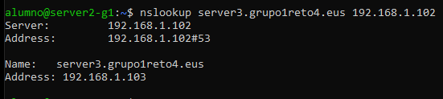

Otra conectividad

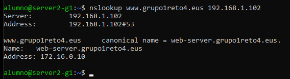

Una vez comprobado volvemos a inicial el servicio.

Fase 4: Web Apache2 y Monitorix

APACHE2:

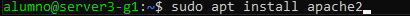

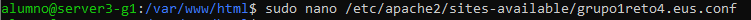

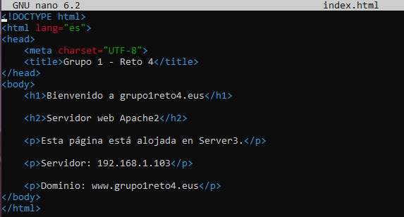

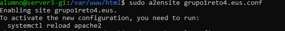

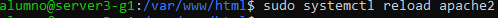

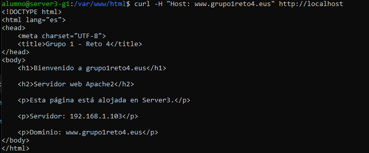

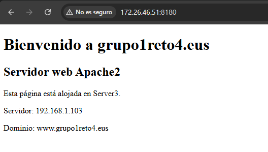

Instalar Monitorix

Ahora instalamos Monitorix en Server3.

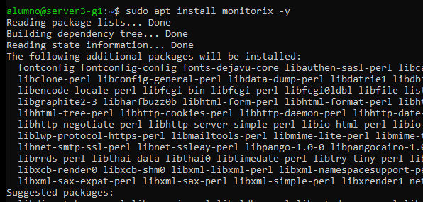

Activamos el servicio,

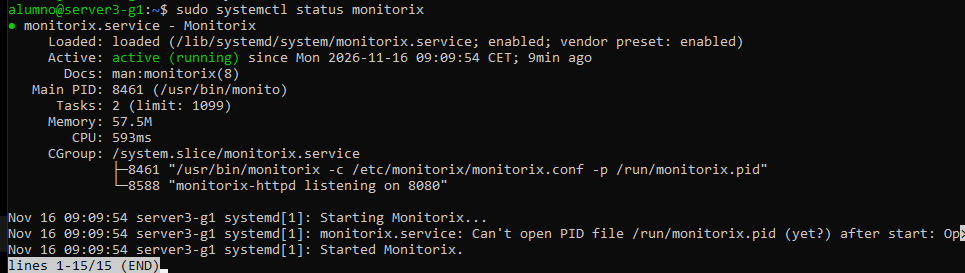

Configurar Monitorix en el puerto 8080

Abre el archivo de configuración:

Cambiamos valores,

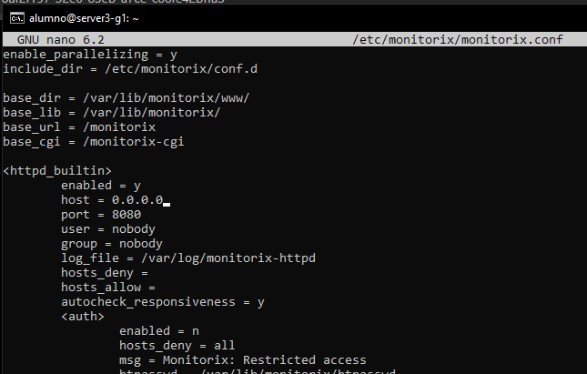

Reiniciamos monitorix y comprobamos que está escuchando en el puerto 8080,

Probar Monitorix desde Server3 y navegador

Ejecuta:

CONFIG NOMBRES DNS RESOLVER EN FIREWALL

Ahora estamos configurando los registros CNAME que hemos creado en el server1, poniendolos en el firewall para poder acceder con los alias,

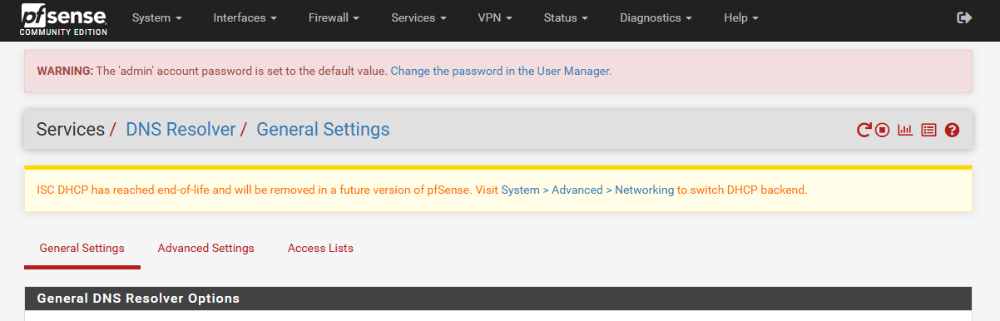

LINKS NOMBRES/IPS DNS

APACHE:

IP:

URL:

PAGINA WEB F1:

IP:

URL:

MONITORIX:

IP:

URL:
